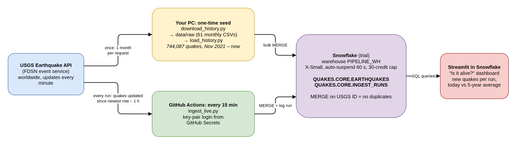

# Quake Pipeline

CS 452 data pipeline: five years of USGS earthquake history bulk-loaded into Snowflake, plus a
GitHub Actions job that pulls new quakes every 15 minutes with nobody touching it, shown live
on a Streamlit in Snowflake dashboard.



Editable source: [docs/architecture.drawio](docs/architecture.drawio)

## Choices at each stage

| Stage | Choice | Why |
|---|---|---|
| 1. Data source | **USGS Earthquakes** (FDSN event API) | No API key, worldwide, updated every minute, and the same CSV format for history and live data, so one table and one parser serve both paths. |
| 2. Ingestion | **GitHub Actions**, cron `*/15 * * * *` | Free for a public repo, version-controlled with the code, and runs when my laptop is off. 15 minutes instead of hourly gives several unattended runs per hour to prove liveness. |
| 3. Buffer | None (direct writes) | At ~20-40 quakes per run, a queue adds cost and moving parts without a benefit; the assignment allows direct writes at this volume. |
| 4. Store | **Snowflake** (30-day trial, X-Small warehouse) | A widely used cloud warehouse; storage and compute are separate, the warehouse sleeps after 60 s, and `MERGE` gives clean upserts. Trial credit ($400) easily covers the one-week project. |
| 5. Liveness | **Streamlit in Snowflake** | Runs next to the data with no extra account or credentials. (Snowflake removed its old built-in dashboards in 2026.) |

## Two paths: seed and live

**Seed (one time, from my PC).** [`scripts/download_history.py`](scripts/download_history.py)
downloaded Nov 2021 - Nov 13 2026 03:00 UTC once, one month per file, into `data/raw/`
(61 CSVs, kept out of git). Months over the USGS 20,000-row limit are split in half until they
fit. Months already on disk are skipped, so USGS is never asked twice for the same data.
[`scripts/load_history.py`](scripts/load_history.py) bulk-loads those saved files
(744,087 quakes) through a temporary staging table and a `MERGE`.

**Live (every 15 minutes, GitHub Actions).** [`scripts/ingest_live.py`](scripts/ingest_live.py)
asks Snowflake for the newest `UPDATED_AT` it has, asks USGS for every quake updated since then
minus a 1-hour overlap, merges them in, and writes one row to `INGEST_RUNS`
(fetched / inserted / updated / status). Workflow: [`.github/workflows/ingest.yml`](.github/workflows/ingest.yml).

## Idempotency (no duplicates)

Both paths share one merge in [`pipeline/common.py`](pipeline/common.py):

1. New rows land in a temporary staging table; if a batch holds the same USGS `ID` twice, only
   the newest version is kept (`QUALIFY ROW_NUMBER() ... = 1`).
2. `MERGE` on `ID`: a new ID is inserted; an existing ID is updated **only** if USGS's
   `UPDATED_AT` is newer (USGS revises magnitudes and locations after the fact); otherwise
   nothing happens.

Proof: loading the full 744,087-row history a second time reported **inserted 0, updated 0**,
and `COUNT(*) = COUNT(DISTINCT ID)`. Live runs fetch overlapping windows on purpose and the
overlap is absorbed the same way.

## Gaps and failure handling

- **Seed → live handoff.** The seed ends at 03:00 UTC on Nov 13. The live job does not start
  from "15 minutes ago" but from the newest data already in the table, so the first live run
  covered the gap automatically. USGS publishes in near real time, so there is no multi-day
  archive lag like some other sources.
- **Runs that fetch nothing new** are normal (no quakes, or all already loaded) and are logged
  as `ok` with `INSERTED = 0`.
- **USGS down at 3 a.m.** The request retries 3 times, then the run logs `error` in
  `INGEST_RUNS` and fails, so GitHub shows a red X. Nothing is lost: the next run starts from
  the newest data in the table again and **backfills** everything missed. Backfill was chosen
  over skipping because the source keeps history, so a late fetch is complete and correct.
  Limit: without an explicit start time, USGS searches the last 30 days, so an outage longer
  than that would need a manual history load.
- **GitHub schedule delay.** GitHub may start scheduled runs several minutes late when busy, so
  run times in `INGEST_RUNS` are not exactly 15 minutes apart. The backfill design makes late
  runs harmless.
- **Spending cap.** A Snowflake resource monitor suspends the warehouse at 30 credits. If that
  ever triggered, runs would fail visibly rather than run up a bill.

## Secrets

- The job logs in as `PIPELINE_BOT`, a Snowflake **service user with no password**: key-pair
  login only (Snowflake now blocks password-only logins for service users).
- Its role `PIPELINE_ROLE` can only use `PIPELINE_WH` and read/write `QUAKES.CORE`.
- The private key lives in a locked folder on my PC and in **GitHub Actions Secrets**
  (`SNOWFLAKE_ACCOUNT`, `SNOWFLAKE_USER`, `SNOWFLAKE_WAREHOUSE`, `SNOWFLAKE_PRIVATE_KEY`).
  It was piped from file to `gh secret set` without being printed. GitHub masks secrets in logs.
- `.gitignore` blocks `*.p8`, `*.pem`, `*.key` and `.env` files; a search of the repo finds no
  key text. Only the **public** key appears, in [`sql/02_robot_user.sql`](sql/02_robot_user.sql).

## Cost

| Item | Billed |
|---|---|
| Snowflake | **$0**: 30-day trial with $400 of free credit, no card on file. Expected use for the week: roughly 2-3 credits/day (each 15-minute run wakes the X-Small warehouse for about a minute plus the 60 s auto-suspend), well under the 30-credit cap. |
| GitHub Actions | **$0**: free for public repositories. |
| USGS API | **$0**: free public service. |

Actual credit use is in Snowsight under **Admin → Cost management**. After the one-week
follow-up the warehouse, database and users are dropped and the trial is left to expire.

## Setup files

- [`sql/01_tables.sql`](sql/01_tables.sql): warehouse, spending cap, database, tables
- [`sql/02_robot_user.sql`](sql/02_robot_user.sql): limited role and key-only service user
- [`dashboard/streamlit_app.py`](dashboard/streamlit_app.py): the dashboard (pasted into a Snowflake workspace)

## Run it yourself

```sh
pip install -r requirements.txt
export SNOWFLAKE_ACCOUNT=... SNOWFLAKE_USER=PIPELINE_BOT SNOWFLAKE_PRIVATE_KEY_PATH=/path/to/key.p8
python scripts/download_history.py --start 2021-11-01   # once
python scripts/load_history.py                          # safe to repeat
python scripts/ingest_live.py                           # what the schedule runs
```
